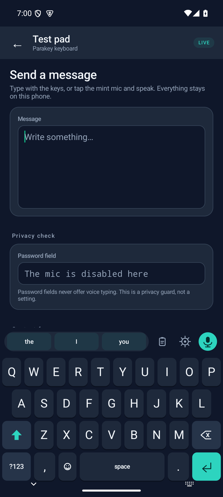
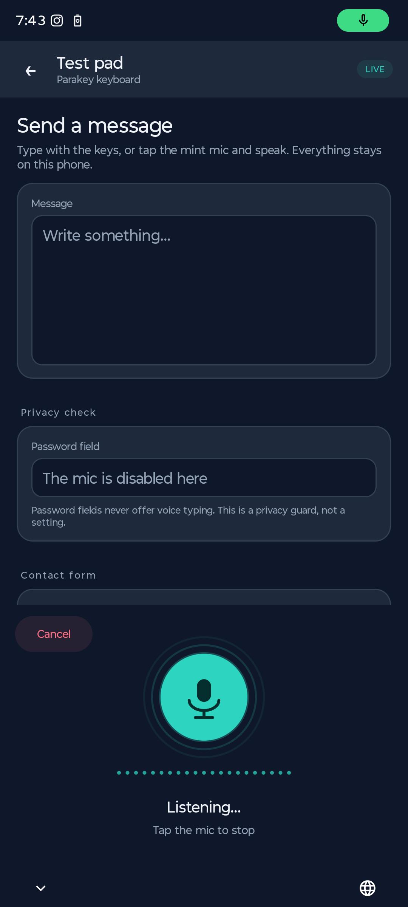
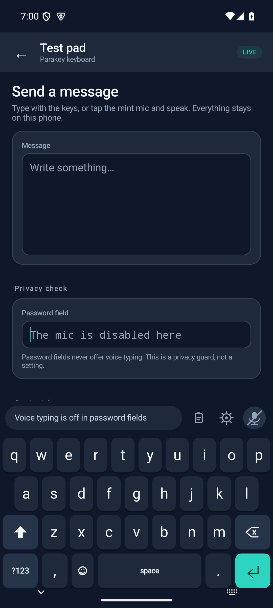
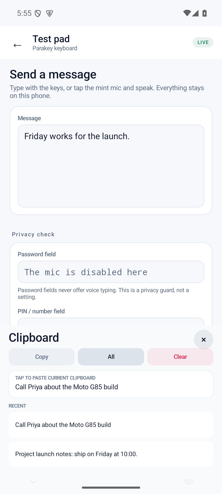

# Parakey

**A real Android keyboard with private, on-device voice typing.**

Parakey puts the NVIDIA **Parakeet TDT-CTC 110M** speech model inside a
Gboard-style keyboard. Tap the mint mic, speak, and the words land in whatever
app you are typing in. Audio stays on the phone. No account, no cloud, no
keylogging, no overlays.



| Voice panel | Password privacy | Clipboard |
| --- | --- | --- |
|  |  |  |

## What works

- A system-wide Android IME: letters, shift/caps, symbols, emoji, backspace,
  enter and a mic key in a familiar Gboard-style layout.
- **No dead gaps:** taps in the gaps between keys snap to the nearest key, with
  extra touch slop so a small finger drift does not cancel a press.
- **Clipboard built in:** a clipboard button opens paste, copy, select-all,
  clear and recent clips.
- **Typing feel:** a 43k-word offline dictionary, word suggestions and
  next-word predictions, high-confidence autocorrect (including contractions
  such as `mightve → might've` and `liek → like`), a conservative two-edit pass
  for longer words, text shortcuts (`btw`, `idk`, `omw`), smart quotes,
  double-space period,
  nearest-key tiled hitboxes, and two-thumb key presses.
- Parakeet TDT-CTC 110M English, int8, running locally through sherpa-onnx and
  ONNX Runtime. Output is cased and punctuated.
- Dictation inserts at the cursor, adds at most one leading space, and offers an
  undo chip.
- Password fields disable the microphone automatically.
- **Appearance:** System, Light, Dark and true-black AMOLED modes with five
  accent palettes (mint, blue, violet, sunset, rose). Light accents are tuned
  for WCAG contrast; the keyboard and setup screen share the same palette.
- **Optional number row:** one toggle adds 1–0 above the letters, using the
  same raised key style and 20% shorter than a letter row. It leaves the
  symbols and emoji pages unchanged. Off by default.
- **Number-only pad:** PIN, phone and quantity fields get a large 3×4 keypad
  with backspace and enter, no letters and no word suggestions. Voice typing is
  disabled there.
- **Long-press gestures:** hold a letter for accents (é, ñ, ü …), hold
  punctuation for alternatives, or hold space and slide to move the cursor.
  Swipe left on backspace to delete a whole word. Recently used emoji move to
  the front of the emoji page.
- **Sound and haptics:** independent key-click and vibration toggles, both on
  by default and skipped when you turn them off.
- Key previews and a live voice panel with an amplitude meter.
- A setup screen that enables the keyboard, downloads the model (126 MB) with a
  SHA-256 check, grants the microphone and opens a test pad.
- A 100-check verification suite, including a physical Moto G85 acceptance gate.

## Try it on Android

Parakey is built for **Android 8.0+ (API 26) on arm64-v8a phones**. The Moto G85
(Android 16) is the reference device used for the live physical test, but the
same APK should work on most modern Android phones. No Google Play Services,
account or network connection is required after the one-time model download.
See [`docs/COMPATIBILITY.md`](docs/COMPATIBILITY.md) for the exact requirements
and OEM caveats.

1. Install the signed APK from the
   [latest release](https://github.com/SrihariPHS/parakey/releases/latest), or
   build it:
   ```bash
   ./gradlew :app:assembleDebug
   adb install -r app/build/outputs/apk/debug/app-debug.apk
   ```
2. Open **Parakey** and tap **Enable keyboard**.
3. Tap **Choose keyboard** and pick **Parakey Keyboard**.
4. Tap **Download model**. The 126 MB Parakeet model is fetched from Hugging
   Face and checksum-verified. For development, `scripts/push-model.sh` pushes a
   local copy instead.
5. Allow the microphone and open the **Test pad**. Tap a field, then the mint
   mic on the keyboard.

The Moto G85 (Android 16, arm64-v8a) is the reference phone. Any Android 8.0+
arm64 device with ~300 MB of free RAM for the model should work. Other phones
are supported in principle; the physical verification gate in this repository
is tuned for the Moto G85.

## Build

Requirements: JDK 17+ (JDK 21 tested), Android SDK 35, build-tools 35.0.0.

```bash
export JAVA_HOME=/path/to/jdk
export ANDROID_HOME=/path/to/android-sdk
./gradlew :app:assembleDebug
./gradlew :app:testDebugUnitTest
```

The debug APK is `app/build/outputs/apk/debug/app-debug.apk`. For a distributable
build, create `keystore.properties` and run `./gradlew :app:assembleRelease`;
the signed APK lands in `app/build/outputs/apk/release/`. The debug build adds
the verification hooks and must not be distributed. The model is not bundled;
the app downloads it on first run and stores it in its private external files
directory.

## Verification

```bash
python3 scripts/verify.py
```

The suite builds, installs and drives the real keyboard on the connected device.
It checks the build, IME registration, every key page, text insertion, password
privacy, ASR accuracy against six known WAV fixtures, latency, warm starts,
AudioRecord capture, rotation, all 20 theme/accent palettes, the optional
number row, the PIN number pad, long-press popups, long-press-space cursor
movement, sound/haptic toggles, monkey taps and the setup flow. Every check writes evidence to
`verification/report.json` and `verification/REPORT.md`.

- The committed report in [`verification/REPORT.md`](verification/REPORT.md)
  is the latest live run. Every user request is mapped to a check and an
  implementation in [`docs/TRACEABILITY.md`](docs/TRACEABILITY.md). **99/100** is achievable on the emulator: the only
  missing point is the physical Moto G85 gate.
- Typing is tested with seeded human profiles (precise/average/sloppy jitter,
  edge/gap taps, adjacent-key slips) plus a raw hitbox-corner gate, dictionary
  corrections and negative controls. See
  [`docs/VERIFICATION.md`](docs/VERIFICATION.md).
- Connect the Moto G85 over USB or wireless ADB and rerun to reach **100/100**.
- `--loop 3` reruns the suite until the threshold is met.

The five verification lanes used during development were build/privacy,
IME/keyboard, ASR/latency, real-life UX, and physical-device acceptance. The
harness is deterministic so the same lanes can be rerun by five parallel agents.

## Architecture

```
app/src/main/java/com/parakey/keyboard/
  MainActivity.kt            setup, model download, status, themes
  keyboard/KeyboardTheme.kt  4 theme modes, 5 accents, contrast-safe palettes
  TryActivity.kt             test pad / contact form / password field
  ParakeyImeService.kt       InputMethodService, dictation state, undo
  keyboard/KeyboardView.kt   custom-drawn Gboard-style keyboard + voice panel
  keyboard/KeyboardLayout.kt key pages and weights
  voice/ParakeetEngine.kt    sherpa-onnx OfflineRecognizer (nemo_ctc)
  voice/AudioRecorder.kt     16 kHz PCM capture with level metering
  voice/ModelDownloader.kt   resumable HTTPS download + SHA-256
  voice/WavReader.kt         dependency-free WAV parser/resampler
  text/TextPostProcessor.kt  cleanup, capitalization, spacing
```

The IME is a plain `InputMethodService` with a custom `View`; there is no
Compose or AndroidX UI dependency. The native payload is the official
sherpa-onnx 2.0.1 AAR (`app/libs/`), which includes ONNX Runtime for
`arm64-v8a` and `x86_64`.

## Privacy and licences

- App code: Apache-2.0 (see `LICENSE`).
- Speech model: NVIDIA Parakeet TDT-CTC 110M, **CC-BY-4.0**. The int8 ONNX
  export is by VocaHQ. See `THIRD_PARTY_NOTICES.md`.
- sherpa-onnx: Apache-2.0. ONNX Runtime: MIT.
- No analytics, ads, telemetry or network calls during dictation. The only
  network request is the one-time model download.

## Development helpers

```bash
scripts/fetch-model.sh       # download model + tokens with SHA checks
scripts/push-model.sh        # push model into the debug app
scripts/verify.py            # 100-check live suite
scripts/verify.py --loop 3   # loop until the 99/100 threshold
```

Debug builds expose a `DebugReceiver` and `SelfTestActivity` for the harness.
They are absent from release builds.
